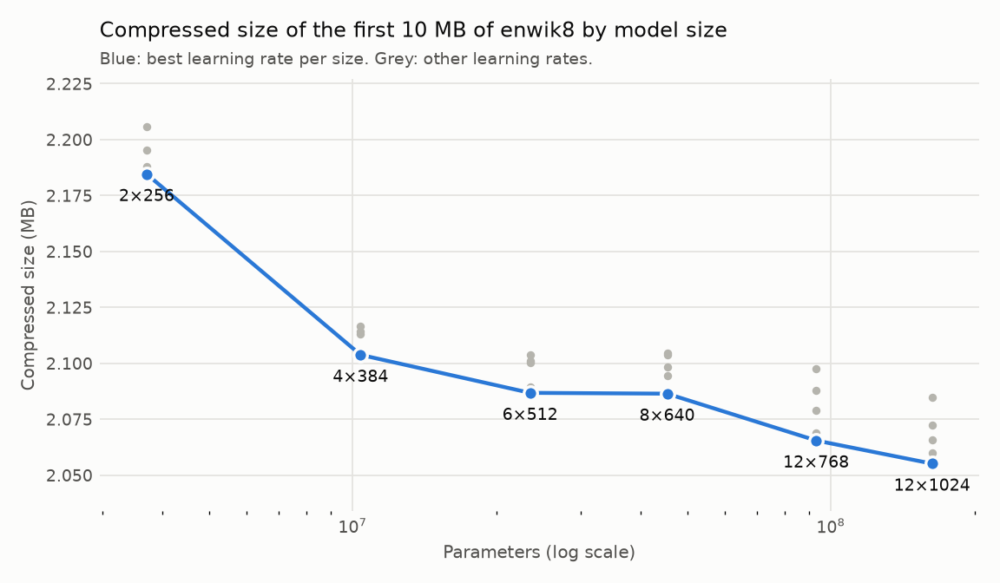
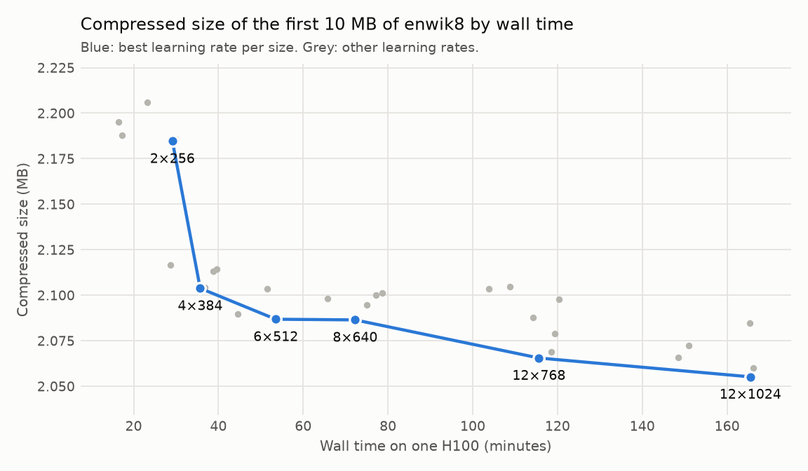

# Model size scaling on the first 10 MB of enwik8

## Setup

- Data: the first 10,000,000 bytes of enwik8, tokenized to 3,065,672 tokens with a 4,096-word dictionary.
- Mode: float bf16, random initial weights, 64 streams, one H100.
- Recipe: the upstream schedule with block length, replay window and replay schedule scaled by the token ratio 3,065,672 / 285,202,830.
- Shapes: head dimension 128 and inner width 2.75 × model width at every size.
- Runs: six sizes, five learning rates each, one seed.
- Bytes are the modeled size of the token stream. The dictionary adds 28,885 bytes to every row.

## A 10.4M-parameter model is 2.4% behind the 162.6M-parameter original

The table shows the best learning rate for each size.

| Size | Parameters | Learning rate | Bytes | Bits per byte | Behind best | Minutes |
|---|---|---|---|---|---|---|
| 2×256 | 3.7M | 1.2e-3 | 2,184,623 | 1.7477 | +6.3% | 29 |
| 4×384 | 10.4M | 1e-3 | 2,103,812 | 1.6830 | +2.4% | 36 |
| 6×512 | 23.5M | 1.2e-3 | 2,086,817 | 1.6695 | +1.5% | 54 |
| 8×640 | 45.4M | 5e-4 | 2,086,454 | 1.6692 | +1.5% | 72 |
| 12×768 | 93.0M | 8e-4 | 2,065,528 | 1.6524 | +0.5% | 116 |
| 12×1024 | 162.6M | 2.5e-4 | 2,055,182 | 1.6441 | best | 165 |

- 12×1024 is the upstream architecture.
- 4×384 is the smallest size within 3% of the best result.
- The largest step is from 2×256 to 4×384: 3.7% fewer bytes for 7 more minutes.
- From 4×384 to 12×1024 the model has 16 times the parameters and takes 4.6 times the wall time for 2.3% fewer bytes.

## Standard compressors on the same 10 MB

| Compressor | Bytes |
|---|---|
| gzip -9 | 3,688,470 |
| bzip2 -9 | 2,916,026 |
| zstd -19 | 2,795,185 |
| xz -9e | 2,720,264 |
| 4×384 plus dictionary | 2,132,697 |

## The best learning rate is near 1e-3 for the small sizes

- The best rate is bracketed at every size: a higher and a lower rate both give more bytes.
- The best rate is 1e-3 to 1.2e-3 for 2×256, 4×384 and 6×512.
- The upstream online rate of 4e-5 is the worst of the five rates tried at 12×1024.
- Doubling the best rate costs between 0.02% (4×384) and 1.1% (12×768).

## 256 streams cost 11% to 13% more bytes than 64

| Size | Streams | Learning rate | Bytes | Against 64 streams | Minutes |
|---|---|---|---|---|---|
| 4×384 | 64 | 1e-3 | 2,103,812 | | 36 |
| 4×384 | 256 | 1e-3 | 2,380,157 | +13.1% | 43 |
| 4×384 | 256 | 2e-3 | 2,375,690 | +12.9% | 28 |
| 6×512 | 64 | 1.2e-3 | 2,086,817 | | 54 |
| 6×512 | 256 | 1.2e-3 | 2,333,933 | +11.8% | 41 |
| 6×512 | 256 | 2.4e-3 | 2,342,999 | +12.3% | 35 |

- With 256 streams the model takes a quarter as many online steps.
- Wall time falls by less than a quarter, because replay steps do not depend on the stream count.

## Limits of these numbers

- Each cell is one seed. The ordering across learning rates is not smooth within a size, which suggests run-to-run noise of about 0.3%.
- Wall time varies between runs of the same size: 2×256 took between 16 and 30 minutes.
- The file is 10 MB. A larger file gives a larger model more data to learn from.

## All 30 runs

| Size | Parameters | Learning rate | Bytes | Bits per byte | Behind best | Minutes |
|---|---|---|---|---|---|---|
| 2×256 | 3.7M | 0.0002 | 2,205,856 | 1.7647 | +7.3% | 23 |
| 2×256 | 3.7M | 0.0005 | 2,185,929 | 1.7487 | +6.4% | 30 |
| 2×256 | 3.7M | 0.0012 | **2,184,623** | 1.7477 | +6.3% | 29 |
| 2×256 | 3.7M | 0.0024 | 2,187,793 | 1.7502 | +6.5% | 17 |
| 2×256 | 3.7M | 0.0048 | 2,195,236 | 1.7562 | +6.8% | 16 |
| 4×384 | 10.4M | 0.00015 | 2,114,237 | 1.6914 | +2.9% | 40 |
| 4×384 | 10.4M | 0.0004 | 2,113,158 | 1.6905 | +2.8% | 39 |
| 4×384 | 10.4M | 0.001 | **2,103,812** | 1.6830 | +2.4% | 36 |
| 4×384 | 10.4M | 0.002 | 2,104,265 | 1.6834 | +2.4% | 37 |
| 4×384 | 10.4M | 0.004 | 2,116,510 | 1.6932 | +3.0% | 29 |
| 6×512 | 23.5M | 0.0001 | 2,100,138 | 1.6801 | +2.2% | 77 |
| 6×512 | 23.5M | 0.00025 | 2,101,263 | 1.6810 | +2.2% | 79 |
| 6×512 | 23.5M | 0.0006 | 2,089,624 | 1.6717 | +1.7% | 45 |
| 6×512 | 23.5M | 0.0012 | **2,086,817** | 1.6695 | +1.5% | 54 |
| 6×512 | 23.5M | 0.0024 | 2,103,643 | 1.6829 | +2.4% | 51 |
| 8×640 | 45.4M | 8e-05 | 2,094,652 | 1.6757 | +1.9% | 75 |
| 8×640 | 45.4M | 0.0002 | 2,098,320 | 1.6787 | +2.1% | 66 |
| 8×640 | 45.4M | 0.0005 | **2,086,454** | 1.6692 | +1.5% | 72 |
| 8×640 | 45.4M | 0.001 | 2,103,663 | 1.6829 | +2.4% | 104 |
| 8×640 | 45.4M | 0.002 | 2,104,753 | 1.6838 | +2.4% | 109 |
| 12×768 | 93.0M | 6e-05 | 2,097,687 | 1.6781 | +2.1% | 120 |
| 12×768 | 93.0M | 0.00015 | 2,078,868 | 1.6631 | +1.2% | 119 |
| 12×768 | 93.0M | 0.0004 | 2,069,021 | 1.6552 | +0.7% | 119 |
| 12×768 | 93.0M | 0.0008 | **2,065,528** | 1.6524 | +0.5% | 116 |
| 12×768 | 93.0M | 0.0016 | 2,087,811 | 1.6702 | +1.6% | 114 |
| 12×1024 | 162.6M | 4e-05 | 2,084,760 | 1.6678 | +1.4% | 165 |
| 12×1024 | 162.6M | 0.0001 | 2,072,431 | 1.6579 | +0.8% | 151 |
| 12×1024 | 162.6M | 0.00025 | **2,055,182** | 1.6441 | best | 165 |
| 12×1024 | 162.6M | 0.0005 | 2,065,880 | 1.6527 | +0.5% | 148 |
| 12×1024 | 162.6M | 0.001 | 2,059,870 | 1.6479 | +0.2% | 166 |

Regenerate the plots and this table with `uv run python scripts/plot_scaling.py results/ledger.jsonl enwik8-10MB results`.
